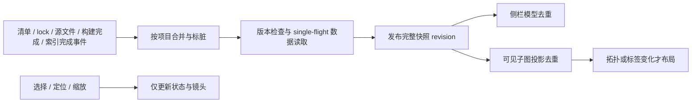

# C++ Modules 可视化交互、性能与 Dependencies 状态设计

状态：0.9.0 实施与验证中。日期：2026-10-20。

范围：Modules 图、共用画布、Project 侧栏 Dependencies 的空态与刷新。本文记录现状实测与建议行为；Packages 图共用组件需做回归，不直接套用 Modules 的入口分类。

## 1. 结论与优先级

1. 首屏单列已有确定原因：测试源文件作为独立根，先耗尽 150 节点预算，依赖节点无法进入画布。应先建立入口分组，再按活动入口分配可见预算。
2. 区分选择、焦点、定位、打开文件；局部展开/折叠作用于当前选择，修改深度作用于当前焦点视图。增加两层父节点上下文。
3. 开图性能同时受 mcppls 查询和 Mermaid 主线程布局影响。先消除重复查询/布局并降低默认子图复杂度，测量后再决定是否更换布局器。
4. Dependencies 有数据时显示折叠分组；无数据时在相同位置显示一行原因/操作提示。数据到达后自动更新，重复事件不产生重复查询或布局。
5. SVG/PNG 导出当前可见子图，明确折叠与截断状态；导出不触发全图展开或重新查询。

## 2. 分析与实测

### 2.1 基线和方法

- 插件仓库：`mcpp-vscode`，commit `f667b5b`。
- 基准项目：相邻的 `mcpp-community/mcpp` checkout，commit `cdc8daa7`。
- `npm run compile` 通过；图模型、Modules provider/CLI、Packages provider 共 15 个测试通过；Project 模型/布局共 30 个测试通过。
- 用真实项目运行 CLI JSON 查询，然后调用当前 `moduleEntries → moduleOwnership → buildModuleGraph → visibleGraph → mermaidGraph`。布局在 Google Chrome headless 中加载仓库打包的 Mermaid，采用 `media/graph.js` 的配置，每种视图连续测 3 次。
- 用真实 `graphPanelHtml` + `media/graph.js`、模拟 VS Code 消息桥验证事件行为。这是浏览器组件测试，不是完整 VS Code E2E。
- 查询结果均为一次观测，未清理索引缓存；不能将两种可执行文件的耗时差异解释成冷/热性能差异。浏览器布局数据不包含 VS Code 桥接和最终绘制开销。

### 2.2 查询与投影

| 项目 | 实测 |
| --- | --- |
| PATH 的 `mcppls` 查询 | wall 13.28 s，user 22.72 s，sys 1.54 s，峰值 RSS 993,608 KiB |
| 扩展优先使用的 bundled `mcppls` 0.0.16 查询 | wall 6.19 s，user 47.15 s，sys 2.61 s，峰值 RSS 1,329,976 KiB |
| bundled 原始 JSON | 207 个 modules，1,794 条 imports；`truncated=false`，`snapshot.indexing=true` |
| 本地 provider 后 | 343 节点、1,648 边、151 根，其中 149 个 `tests/` 根；识别到的入口为 `src/main.cpp` |
| 文件存在性与归属准备 | 约 11.0 ms，199 次存在性检查 |
| `buildModuleGraph` | 约 4.4 ms |

RSS 来自 `/usr/bin/time` 的查询进程统计，不能当作 VS Code 整体内存。多核 CPU 时间和查询进程内存说明首次索引/查询值得优先排查，但没有对风扇或功耗直接测量，也没有证明查询内部哪个阶段占比最大。

| 视图，默认下游深度 3 | 可见节点/边 | 投影 | Mermaid render 三次 |
| --- | --- | --- | --- |
| 项目概览 | 150 / 0 | 0.79 ms | 281 / 266 / 249 ms |
| `src/main.cpp` 焦点 | 78 / 300，边预算截断 | 0.72 ms | 646 / 605 / 599 ms |
| `mcpp.pm` 焦点 | 7 / 6 | 0.34 ms | 28 / 25 / 28 ms |

所有视图均应显示“索引尚未完成”，因为 provider 将 `indexing=true` 合并进了 `truncated`。此处不是完整、稳定的索引快照。

### 2.3 已确认的问题与边界

| 现象 | 代码/测试证据 | 判断 |
| --- | --- | --- |
| 首屏一列且 `＋N` 很多 | `src/graphs/model.ts:46` 的投影先加入全部 roots 再 BFS；真实项目 151 根挤满预算，得到 0 边；另用 150 根共享一个依赖的确定性样本复现 | 必修复预算调度；调大深度不能解决 |
| 单击打开文件 | `media/graph.js` 的 click 调用 `activateNode → open`，组件测试确认 | 单击改选择，双击打开 |
| Focus 看似与选择混淆 | 当前 Focus 已发送选中 ID，host 写入 `current.focus`；选中高亮 CSS 叫 `is-focused` | 不应误诊为 Focus 总操作图根；需分别表达 selection/focus/camera |
| 选中后展开无变化 | `expanded` 是 Set；已在默认深度内的内部节点展开可能没有效果；同一节点重复展开幂等 | 改为可连续推进的每节点局部深度 |
| 父节点上下文不足 | 焦点仅加入直接 importers，并且在遍历下游前全部加入预算 | 增加独立上游深度与配额，防止父节点再次耗尽预算 |
| 不变数据重复布局 | 每次 `publish` 都重发 source、完整 search，draw 总调用 Mermaid；相同消息两次触发两次 render，组件测试确认 | 数据、拓扑、选择、镜头分通道去重 |
| 查询过期但仍消耗 CPU | generation 丢弃旧结果，`runProcess` 无取消参数；刷新可再启动查询 | 丢结果不等于取消任务，需 single-flight/取消 |
| Dependencies 消失 | `src/views/models.ts:649` 在无声明时返回空数组；`models.test.ts` 明确断言隐藏；清单读取失败时 `buildProjectTree` 只返回错误行 | 数据状态不应通过删除入口表达 |
| 是否必须构建才有 Dependencies | 真实清单解析得 12 条声明，传入空 lock 仍有 12 个子项 | 已声明依赖不依赖构建；间歇消失的具体触发尚未完整复现 |

可能相关但尚未复现的路径：manifest 原子替换/短暂读取失败、活动文件切换导致项目发现改变、workspace 继承声明缺失。应通过状态日志和测试进一步定位，不将其写成已确定原因。

复测命令：

```bash
npm run compile
node --test dist/test/graphs/model.test.js dist/test/projects/moduleGraph.test.js dist/test/projects/moduleGraphCli.test.js dist/test/projects/dependencyGraph.test.js
node --test dist/test/views/models.test.js dist/test/views/projectLayout.test.js
mcppls query module --graph --root <mcpp-checkout> --timeout 20 --format json
```

现有 `tools/benchmark-dependency-graphs.mjs` 只覆盖链、宽图、共享图，缺少多入口/测试根耗尽预算的样本。实施时应将本次真实快照统计、根洪泛和交互断言纳入可复用 harness；临时测量脚本不作为长期测试资产。

## 3. 根与首次进入

### 3.1 数据图与展示根分离

真实 import 图保持身份和方向：`A → B` 表示 A 导入 B。展示结构另设 `root group` 与虚拟包含边，不写回 import 数据、不计入 imports 数量、不占语义深度。

- Main：默认 `src/main.cpp` 与显式 `[targets.<name>] kind=bin/main`。多个 main 放入 Main 虚拟组，保留目标名称。
- Library：显式 `[lib].path` 优先；默认路径遵循 `src/<包名末段>.cppm`。只将实际存在/被 provider 提供的模块作为真实根；声明存在但文件缺失时显示诊断。库目标 `kind=lib/shared` 按实际配置关联，不能一概标为可执行入口。
- Tests：按 `[test].discover` 分类（默认 `tests/**/*.cpp`，含排除 glob、`[]`）；一个测试可直接作为入口，多个测试使用 Tests 虚拟根并显示计数。
- Other：未被入口覆盖的组件、孤立模块、循环组件有单独入口列表，按需打开，保证可达；不要重新把全部组件作为首屏 roots 注入。
- 外部/path 包保持现有一跳边界。Tests 可引用任意模块，不能把“测试目录下的每个源文件”武断当作语法上的 main。

当前 mcppls JSON 未提供测试目标/入口分类。V1 根据清单 glob 与已知文件分类，标注为“测试入口（按配置）”；复用并对齐 mcpp 的 glob 契约，不自行解析 C++ main。零 imports 测试可能不在 JSON 中，可按 discover 有界发现文件作为候选；扩展仅处理文件/配置元数据，C++ 语义继续归 mcppls。后续若需准确目标元数据，先协商上游接口。

### 3.2 默认视图

首次无恢复状态：选用当前编辑器所属的本项目入口（能可靠关联时），否则 Main → Library → Tests → Other。展开该活动入口下游 3 层；上游默认 2 层。旁边常驻入口选择器，显示其他入口/组及计数。默认 3 层仍受预算约束。

虚拟组进入后先显示有界入口批次（建议 20 个），选中某测试后按该测试展示依赖。切换到 Tests 不一次布局 149 个测试及其全部边。概览显示紧凑的 Main/Library/Tests/Other 入口组；有 Main/Library 时同时展开活动入口首层，避免概览只有孤立分类块。大型多个 Main/Library 同样分页。

Library 默认文件不存在时不创建假库。本项目没有默认 `src/mcpp.cppm`，`mcpp.pm` 可从 Other 访问，不能凭名称将其当作默认 lib 根。

保存各项目、模式及入口/焦点的导航状态；重开优先恢复。恢复 ID 不存在时退回可用入口，并给出简短提示。

## 4. 选择、焦点与局部操作

状态拆分为 `selectedId`（操作对象）、`focusId`（当前子图中心）、`camera`（缩放/位置）、`activeEntryId`（入口）、`upstreamDepth/downstreamDepth`、每节点方向性的展开/折叠覆盖。工具栏同时标明“焦点：A / 选中：B”。

| 操作 | 行为 | 是否重新布局 |
| --- | --- | --- |
| 单击节点 / Space | 选择节点，同步 host 选择状态 | 否 |
| 双击节点 / Enter / 打开文件按钮 | 打开节点关联文件，沿用现有只读旁开行为；多文件仍选择 | 否 |
| 定位选中（建议 C） | 将当前选中节点移入视口，保持合理缩放 | 否，节点可见时仅改镜头 |
| 定位焦点 | 镜头回到现有 `focusId` | 否 |
| 设为焦点（建议 F） | `focusId = selectedId`，生成其上下游子图，居中 | 拓扑变化时 |
| 展开下一层 / 节点 `＋N` | 只推进选中节点该方向的可见边界一层；可连续操作 | 拓扑变化时 |
| 折叠 | 只关闭选中节点该方向分支，保留节点 | 拓扑变化时 |
| 下游深度 / 上游深度 | 调整当前焦点/活动入口的基线深度；覆盖规则见下文 | 拓扑变化时 |
| 返回项目概览 / 后退 | 恢复原入口/焦点、折叠及镜头，而不是每次清空状态 | 按缓存恢复 |
| 搜索命中 | 可见节点仅选择并定位；隐藏节点显示“以此为焦点”动作后进入 | 仅必要时 |

键盘快捷键仅在画布有焦点且未输入搜索时响应。拖拽抑制 click/dblclick；折叠按钮阻止冒泡，不打开文件。双击产生的 click 仅做选择，无需延时单击。

### 4.1 局部展开的精确定义

- `展开下一层` 从所选节点当前已展示的连续方向边界继续一跳，不仅把节点加入 Set。已显示 3 层时再点可展示第 4 层，再点可展示第 5 层。
- 用每节点/方向的局部深度覆盖或 frontier 记录表达进度；全局深度与局部覆盖取较大有效深度，显式折叠优先。修改深度只重置当前焦点的局部覆盖，UI 明示；其他焦点历史不受影响。
- DAG 共享节点由其他未折叠分支仍可达时保留；从被折叠节点出发的该方向边隐藏。不按整棵树递归删除共享节点。
- 上游沿反向索引走 2 跳，下游沿正向索引走 3 跳，分别搜索。上游节点只扩展祖先链，不顺带展开其兄弟依赖；禁止将两次遍历结果做无条件诱导边补全而显示无关分支。
- 环使用 visited/剩余深度防止无限遍历，保留原始边方向。上游在左、下游在右；环布局可偏离严格左右层级，应仍保留可辨箭头。
- 顶部明确写“父节点（导入者）2 层”“依赖 3 层”，避免“向前”方向歧义。

### 4.2 预算与进度

实施默认采用 60 节点/80 边，模型硬上限保留 150/300。原候选 80/120 在真实密集图上仍超过布局目标，按实测缩小默认预算，并去除重复的 import 边标签。焦点和选中节点优先纳入，先保留一条有意义的连接路径，才补其他节点；不允许 roots 或大量父节点一次耗尽预算。

父/子方向设独立软配额（建议父侧最多 20 节点，其余给焦点和下游，空闲额度可借用）。按层、入口/分支轮转，稳定 ID 排序；高出度节点分页追加邻居。节点与连接边成对进入预算，防止边截断留下大量无连接节点。

区分 `隐藏 N 项`（深度折叠）、`还有 N 项`（分页/预算）、`索引尚未完成`（数据不全）。达到硬预算时，展开须提供可执行出口：以该节点为焦点 / 隐藏其他分支 / 下一批；不能让按钮一直无效果。处于预算边界时不承诺每次展开都能增加一层。

## 5. Dependencies 始终有明确状态

### 5.1 显示规则

保留 Basics、依赖位置、Common commands 的顺序。有项目上下文时该位置始终占一行，使用稳定树节点 ID；无内容时使用普通信息行，不显示空“库依赖”下拉菜单。

| 状态 | 展示 | 可执行动作 |
| --- | --- | --- |
| 有清单声明，lock 缺失 | `Dependencies (12)`，子项显示声明约束或 path；说明尚未解析 | 查看图；按需构建/解析以补齐版本 |
| 声明读取中 | `正在读取依赖…`，已有结果保留 | 无需手动操作 |
| 确认无声明 | `此项目未声明依赖`，无展开箭头 | 可提供添加依赖动作 |
| 元数据未生成且无法获取依赖 | `依赖数据尚未生成，构建后重试`，无展开箭头 | 点击运行已有构建命令，仅在构建确实能生成所需数据时显示 |
| 清单读取失败 | `暂时无法读取依赖，点击重试`，无展开箭头；已有结果则保留并标记过期 | 重试；详情写 tooltip/日志 |
| Modules 索引进行中 | `模块索引中，完成后自动更新` | 不要求重复构建 |
| 未信任 / provider 不可用 | 对应的信任/安装/重试提示 | 仅提供适用动作 |

包依赖以清单声明为基础，lock/索引补版本和关系，不能以是否构建决定入口存在。测试依赖、build 依赖、条件依赖保持分类标记。有效数据到达后信息行自动替换成 Dependencies 分组；确认清单删除依赖后反向切换为无声明信息行。

保留“没有项目”的整页空态；清单短暂失败但已有项目上下文时保留项目与依赖状态。只有确实移除/切换项目才清理旧上下文，不能让原子写入的一瞬间被误判成新项目无依赖。

### 5.2 精确的数据状态

`undefined` 和 `[]` 不再同时承载“未读取/失败/真为空”。增加带类型的状态，例如 `loading | ready | empty | stale | unavailable | error`，附 root、revision、原因和上次有效数据。无数据与有旧数据的 loading 分别渲染。

一次读取拿到完整快照后原子发布。先读 summary、再读依赖而分别刷新会造成中间空态，应避免。清单损坏/不可读不能被 tolerant parser 静默当成 ready-empty；成功解析为空才清除旧列表。权限错误不显示“请构建”。

## 6. 及时刷新而不重复工作

### 6.1 一条刷新管线，按成本分层



| 变化源 | 最少必要工作 |
| --- | --- |
| manifest 新增/修改/删除 | 重读清单和入口/测试规则，更新侧栏；Modules 图仅在分类/语义可能改变时标脏 |
| lock 改变 | 补齐依赖版本/Packages 模型；不因此启动 Modules 查询 |
| C++ 文件增删改 | 合并成一次 Modules dirty；当前图保持可交互 |
| mcpp 构建/解析任务结束 | 同项目仅安排一次刷新；与随后 lock/索引事件合并；先判断结果是否变化 |
| mcppls 索引完成/新 generation | 获取新快照；只接受当前请求/项目的版本 |
| active editor 改变 | 更新项目选择；同 root 无数据变化不重读依赖、不递归数源文件 |
| bridge 状态更新 | 仅更新服务状态子树，不对所有依赖重新做同步 IO |
| 展开/折叠/深度 | 复用缓存图与邻接索引，只投影和必要布局 |
| 单击/定位/缩放/相同消息 | 无查询、无投影、无布局 |

合并建议：文件事件 trailing debounce 200 ms，连续事件最大等待 1 s；事件到达立即记录 dirty，避免“等下一事件”才刷新。大规模写入时按最大等待处理最新快照，后续若仍变化再次合并，不把每个事件排成任务。以上为初始参数，需实测调整。

### 6.2 单任务、版本与去重

- 每 `(root, provider)` 最多一个进行中查询。新事件只标记 `dirtyDuringFlight`；结束后比对 revision/文件指纹，必要时补一次，补跑期间新变更仍会被记录。
- 手动刷新加入同一队列；快速点击合并，不另开进程。切换项目/关闭可取消旧查询；超时/出错后保持可重试。generation 继续防止旧结果覆盖，但增加 AbortSignal/子进程终止，不能只丢弃结果。
- 记录三层版本：source revision（快照与配置）、visible signature（节点、边、标签和折叠标记）、camera/selection state。source 更新但可见图不变时无需布局，选择更新无需全量图消息。
- mcppls 的 generation 不能假设跨进程单调可比。缓存键加入项目、provider 可执行文件版本/会话、配置签名；跨会话以内容摘要确认变化。
- `graphSnapshot`、`projection`、`selection`、`camera` 分开发布；搜索数据仅随 source revision 更新，查询结果最多显示 50 项，避免每次重建全部 datalist。
- Webview 对相同 visible signature 直接复用 SVG；只保留最新待布局请求，不排队渲染每个中间状态。布局结果提交前检查 viewKey + revision；重开视图时 host 只发布一次，修复目前 `load/publish` 后又 `publish(true)` 的重复路径。
- 普通数据刷新保留镜头和所选节点位置；只有初次打开、显式 Fit、设为焦点时调整镜头。主题修改优先更新 CSS；确需重绘则合并一次。
- 缓存邻接/反向邻接/节点索引；文件归属检查以目录缓存、有界并发进行。实测当前 IO 约 11 ms，优先级低于查询和布局。

### 6.3 隐藏视图与索引未完成

侧栏可见时更新依赖展示；图隐藏时只记 dirty，不布局、不启动仅服务该图的重查询。返回可见时立即读最新缓存并至多启动一个必要查询。缓存按项目/模式做 LRU 与容量约束；保留上下文不应导致无限保留全部项目 SVG/图。

现有 mcppls CLI 只有拉取查询，尚未验证可订阅的图完成事件。因此分两级实现：

1. 优先接现有任务完成、文件变化，以及已有 bridge 中可验证的索引完成信号；不能假定 bridge 暴露图 revision。
2. 对 `snapshot.indexing/preparing=true`，在图可见时用低频退避探测（建议前次结束后 2/5/10/20 秒，最多自动 4 次；失败停止自动循环并显示重试）。若探测本身会重新启动全量索引或每次都返回同一未完成状态，不继续靠轮询解决：保留部分图，推进上游复用常驻索引/完成通知契约。

无事件、重试预算耗尽时无法保证索引完成瞬间自动可见，应明确显示“部分数据，可刷新”，并将常驻快照/完成通知列为实现完整及时性的上游依赖。不得用高频昂贵 CLI 查询冒充实时更新。退避时间从上次查询完成计算，始终遵守 single-flight。

### 6.4 性能策略与布局器

V1 保留 Mermaid/SVG，减小默认图并按 signature 缓存；render 串行合并、关闭多余自动 fit。不能直接将 `mermaid.render` 搬进 Web Worker：当前布局依赖 DOM/字体度量。

若有界可见图仍超出交互目标，再评估“独立图布局 worker + 自有 SVG renderer”，先做相同真实图基准比较。SVG DOM 是导出、键盘访问与当前节点规模的合适起点；全图 Canvas/WebGL 和完整替换渲染栈不作为首轮前提。

## 7. SVG / PNG 导出

增加“导出”菜单，默认导出**当前可见子图的完整画布**，包括当前折叠、父/子层数、标签与主题，使用内容包围盒，不受当前 pan/zoom 裁切；明确不是整个未展开工程图。未完成/预算受限时附“部分视图”说明与元数据。未来若需“当前视口截图”单独命名。

- SVG：克隆当前已完成布局的 SVG，去掉 CSS transform，写入 viewBox/尺寸，将 VS Code CSS 变量、必要计算样式内联；避免外部样式、脚本与网络字体依赖，背景支持主题色/透明。保留文本和箭头，不添加编辑器按钮。
- PNG：从同一 SVG Blob 解码到 canvas，默认 2×，可选 1×；先校验尺寸/像素数（建议上限 16 MP、单边 8192，超出时降低倍率并提示或改导 SVG），toBlob 后释放 object URL/canvas。
- 复用当前已提交 revision；布局过程中可等最新一次结束，导出期间固定快照，避免 A 版本 SVG 混入 B 版本标题。导出不触发查询、展开或额外布局。
- Webview 只传生成的受限载荷/请求 ID，host 校验格式、尺寸与总大小，再走 `showSaveDialog + workspace.fs.writeFile`；取消保存无副作用。PNG 需要 CSP 允许本地 Blob 解码，调整范围仅限该用途。
- 文件名如 `mcpp-modules-main.svg/png`。字体就绪后生成；测试离线打开、暗/亮主题、中文、箭头 marker、透明背景、多行标签和超限降级。

## 8. 实施分期与验收

### P0：确定性问题与基本交互

- `src/graphs/model.ts`：入口/虚拟组投影、父子双向遍历、连接预算、每节点展开进度。
- `src/projects/moduleGraph.ts`：入口分类元数据；保留真实 ID/一跳外部边界；测试规则匹配。
- `src/graphs/panelHtml.ts`、`media/graph.js`、CSS：单击选择/双击打开、定位与焦点区分、上下游深度与导航恢复。
- `src/views/models.ts`、`projectView.ts`：明确依赖状态，有数据分组、无数据单行提示；更新旧的“无依赖必须隐藏”测试。

验收：真实 mcpp 首次可见 Main 的连接依赖；Tests 显示 149 的观测计数但不整批布局（计数随当前快照变动）；入口可达、无假 lib；单击 0 次 open，双击 1 次 open；Focus(B) 使用选中的 B；折叠 B 不误折叠焦点 A；父链默认显示两跳。

### P1：刷新、查询与布局去重

- host 引入每 provider 的刷新协调器、dirty/revision、取消与缓存；图 payload 分层；侧栏避免 bridge 每次变化都同步重读整个项目。
- Webview 做 signature 去重，去掉重复 publish 路径；隐藏页面暂停布局；对未完成快照实行有上限的重试。
- 增加查询、投影、布局次数与耗时调试计数，日志按 root/revision/requestId 关联，默认不输出全图。

验收：100 个连续文件/任务事件合并处理；同版本只发布一次；进行中事件最多触发必要的一次补跑，后续新事件不丢失。lock 改变不查询 Modules；单击/定位不布局；相同消息两次仅布局一次；项目切换旧结果不能覆盖新图；隐藏图布局次数为 0；索引由 partial 变 ready 时更新，不要求关闭重开。

### P2：导出与真实项目压力回归

- 完成 SVG/PNG 导出、离线打开与图像校验。
- 扩充基准：150+ 测试入口、宽扇出、密集共享 DAG、深链、循环、高上游扇入、10k 节点/50k 边纯模型；真实 mcpp 同时测试未构建、构建后、索引中与索引完成。
- UI 集成回归 Packages / Modules 切换、已有依赖行定位、只读源码旁开、多项目状态与主题切换。现有 UI 脚本“单击打开”的断言改为双击，并添加单击不打开断言。

### 8.1 初始性能目标（待实现后验证，不是本次已达成）

| 指标 | 目标/测量方式 |
| --- | --- |
| 单击选择、定位、缩放 | 0 查询、0 Mermaid render；本机输入处理尽量 < 50 ms |
| 数据就绪后的常规可见图布局 | 默认预算下 median ≤ 200 ms，p95 ≤ 400 ms；至少 20 次，记录节点/边与浏览器版本 |
| 热缓存重开且可见图未变 | 0 查询、0 新布局；必要时复挂缓存 SVG |
| 完成事件到 UI 更新 | 快速数据读取时 ≤ 1 s；需要 CLI 时为合并窗口 + 一次查询 + 布局，分别记录 |
| 冷开数据加载 | UI 立即可操作并显示阶段；不承诺压缩现有 6–13 s 查询，需上游索引复用后再定数值目标 |
| 资源稳定性 | 每 provider 同项目最多 1 查询，任务结束后无持续重绘；重复 20 次进入/离开后缓存不无界增长 |

Dependencies 回归矩阵必须覆盖：无 lock 但有声明、真零声明、读取失败、临时无数据后变有、数据有后清单清空、原子写入、workspace 成员切换、构建结束与 lock 事件重叠。空态与错误都要保留稳定位置，不能重新变成“直接不显示”。

## 9. 实施决策

采用：默认活动入口下游 3 层/父节点 2 层；多个测试使用虚拟根并按 20 项分页；选择与焦点显式分离，提供定位选中/定位焦点；实测调整后的 60/80 默认预算与 150/300 硬预算；无依赖数据使用同位置单行提示；自动刷新采用事件合并和内容版本去重；导出默认可见子图全画布。

首轮顺序建议 P0 → P1 → P2。若索引完成通知/复用不可用，单独推进上游契约，不将“风扇/CPU 开销已解决”作为仅修改前端布局即可达成的承诺。

## 10. 实施验证补充

- 默认视图保留完整数据，投影为 60 节点/80 边以内；Main 优先，Tests 按 20 项分页。语义图不包含虚拟分组边。
- 实现单击选择、双击打开、独立定位、上下游深度、局部推进、返回导航，以及 SVG/PNG 导出。
- 文件事件按项目合并；lock 只刷新包数据；隐藏图不发起新查询/布局；未完成且变化中的结果有限重试，结果不变则停止。
- 查询与可见内容分别缓存，Webview 以 source/theme 复用最多八份 SVG；选择与镜头操作不触发布局。临时清单失败保留旧依赖，成功空声明显示单行信息。
- 真实项目新投影为 51 节点/80 边；20 次 Chromium 布局 median 163 ms、p95 171 ms，投影约 0.63 ms。对照旧 main 视图 78 节点/300 边的约 600 ms，这一比较包含预算和标签简化的共同收益，不是相同图大小的布局器性能比较。
- 浏览器组件、host 调度、单元和 Extension Host 验证均独立执行。最终 CI、Release 与真实 VS Code 验收记录随发布补齐；首轮冷查询仍受上游索引开销影响。

### 紧凑工具栏

导出合并为一个下拉按钮，包含 SVG、PNG、Copy Mermaid。默认仅展示入口、搜索和视图菜单；上下游深度及定位焦点放在视图菜单内。选择栏保留 Focus、Locate selected，将展开、折叠、父节点和打开源码收进节点右键菜单，移除额外的 Node actions 选择器，节点上的加号与双击仍可直接操作。相同的焦点与选中身份只显示一次；身份不同才同时显示。菜单支持 Shift+F10／菜单键呼出、方向键导航、Escape 关闭并恢复节点焦点，以及点击外部关闭。功能均保持可达，不新增默认输入步骤。

Refresh 与 Export 使用主题蓝色／绿色，统一 28px 控件高度和 CSS 下拉箭头；View options 中两个深度选择器统一为 72px，数字和右侧箭头对齐。文件监听与编辑器保存事件之外，可见的项目栏每两秒只检查 manifest／lock 两个文件的元数据；未变化不读取依赖、不运行 CLI、不布局，隐藏时停止检查，用于监听事件丢失时恢复。
