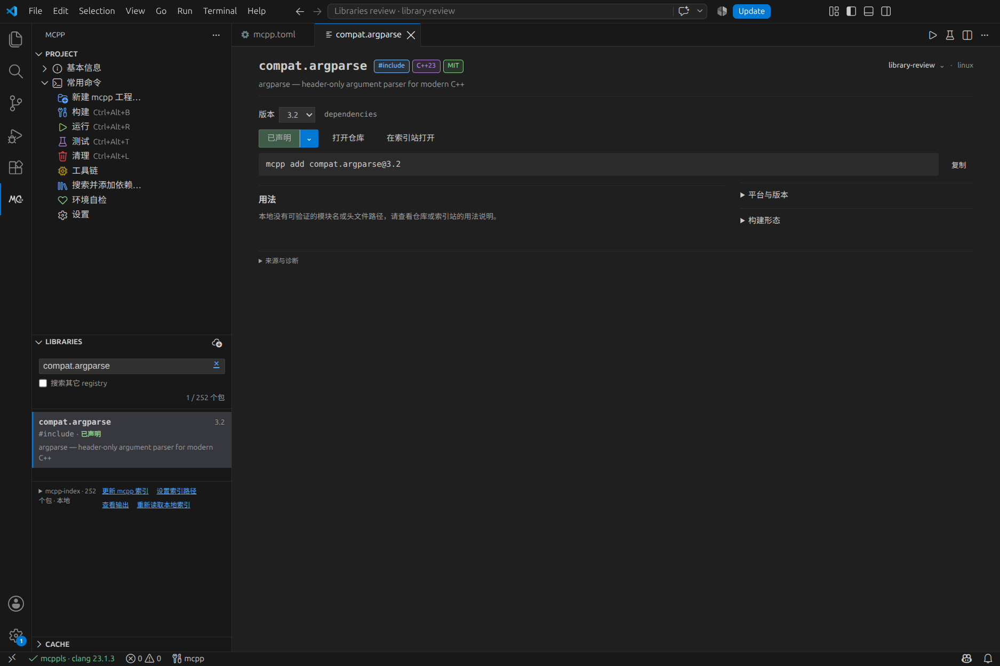
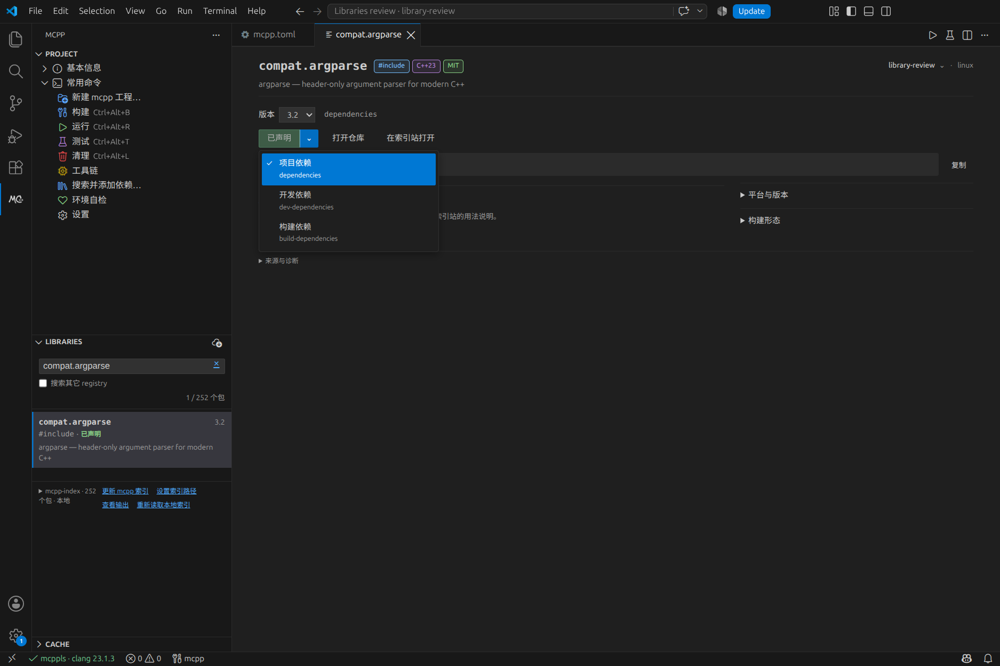
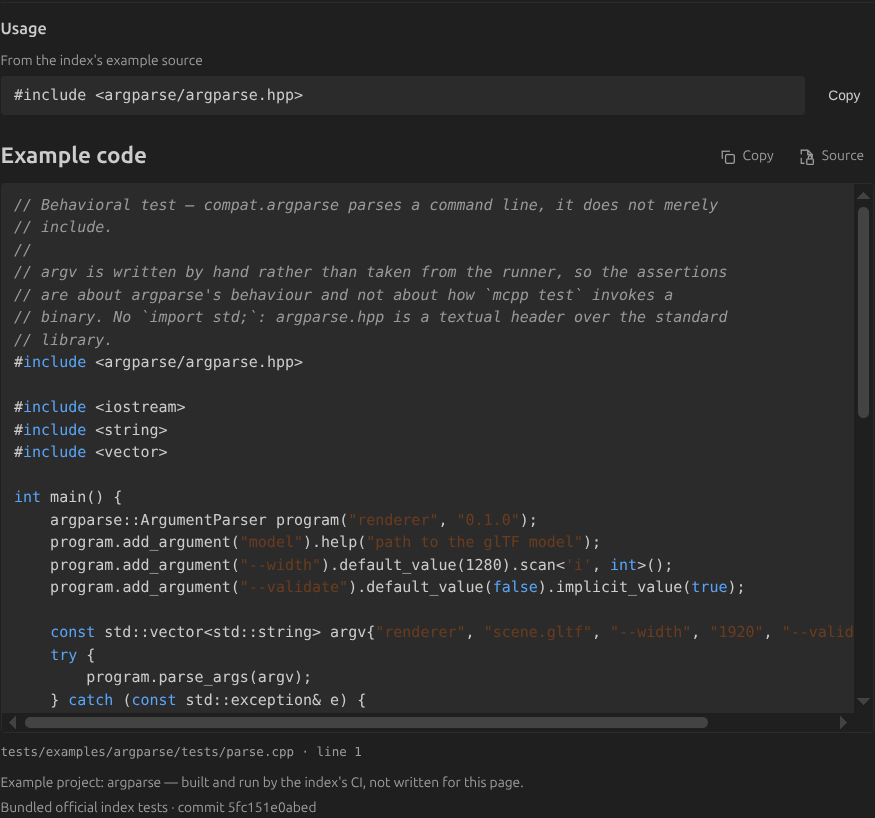
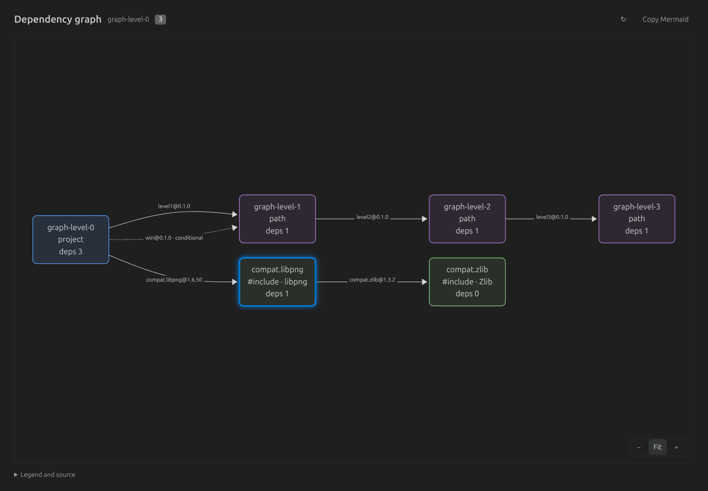

# Libraries 本地验收与 review

日期：2026-10-19（Asia/Tokyo）
分支：`feat/libraries-ux`
方案：[Libraries 与包详情页优化](2026-10-18-libraries-ux-optimisation-plan.md)

## 核心变化

1. 默认浏览官方 mcpp-index。新版路径为 `$MCPP_HOME/indices/mcpplibs`，旧版仅兼容 `registry/data/mcpplibs`；不再扫描所有 registry 并混入 xim。本机官方 252 包、xim 337 包是本次环境的观察值，不作为固定产品数量。
2. 详情顶部去掉空白占位；包名后紧跟引入方式、C++ 标准和许可证小标签。右上角切换项目并显示环境；版本选择与添加操作集中在首屏。
3. 用添加按钮旁的二级菜单选择项目、开发、构建依赖，去掉 dev checkbox。选择结果同步按钮、命令预览及声明位置；菜单支持键盘操作。
4. manifest 声明与 lock 解析版本分别展示。项目切换、磁盘修改、添加结果和异步请求都绑定对应项目与包，避免旧结果污染当前页面。
5. 详情保留单页阅读。宽屏双栏、窄屏单栏；平台矩阵、构建信息和来源诊断默认收起。无真实示例时不猜造可复制的 include/import。

真实本地 review 窗口（中文界面）：





## 本地体验

运行：

```bash
node tools/review-libraries.mjs
# 已经打包时：
node tools/review-libraries.mjs --no-package
```

脚本将 VSIX 安装到隔离扩展目录，用隔离 VS Code 用户配置打开 `.dev-profile/library-review`。使用真实 `mcpp` 与官方本地索引，保留后续手动编辑；可通过 `MCPP_DEV_CODE` 指定 VS Code 命令。进入 MC++ → Libraries，打开 `compat.argparse` 或 `compat.zlib`。

建议 review：

- 看包名标签、右上角项目选择和首屏密度；拖窄详情检查换行。
- 展开添加按钮旁的箭头，比较三种依赖类型及命令/清单预览。
- 选择 secondary 子项目，添加依赖后核对写入对应 `mcpp.toml`。
- 切换普通与开发分组，检查已有声明提示；手动修改 manifest/lock 后观察状态更新。
- 搜索并用方向键、Enter 打开详情；切换包后返回，检查查询、选项及滚动状态。

## 测试与证据

环境：Linux，VS Code 1.132.0，真实 mcpp 2026.10.16.3。

| 验证 | 结果 |
| --- | --- |
| `npm test`，包含配置、翻译、图标、生成文件一致性检查 | 695 通过，0 失败 |
| `npm run test:e2e`，真实 VS Code，语言服务五种能力变体 | 每种 8 项，共 40 通过 |
| `node tools/test-libraries-ui.mjs`，真实 VS Code Webview | 17 项通过 |
| `npm run package` | VSIX 152 文件，约 1.37 MB（含 Mermaid 与官方测试快照） |

Webview 验证覆盖：官方源及已有声明；lock 新建与删除；索引更新失败保留数据；键盘搜索及文档稳定；真实 `add --dev` 与磁盘核对；添加过程中切包；慢查询过期丢弃及跨源有限预览；项目切换后的写入位置；标签和依赖二级菜单；搜索/解析失败重试；真实 20 秒解析超时恢复；添加失败重试；侧栏宽度及过滤延迟；三种主题下的响应式布局。

侧栏按 180/280/420px 验证；详情按 480/800/1200px，在深色、浅色、高对比主题下均无横向溢出。过滤计时与布局测量、完整结果 JSON 由脚本写入 `.dev-profile/libraries-ui-artifacts/`。可选 Playwright 驱动装在仓库外，复现命令见脚本头注释。

新增行为测试覆盖新版/旧版/显式路径、默认排除 xim、项目状态覆盖与索引缓存、同名来源与依赖分组、异步操作关联、文件变化及 watcher 释放。测试夹具使用临时目录，不依赖本机包数量。

`data/buildscript-api.json` 和 `data/toml-schema.json` 另有独立 checkpoint 更新：对齐本机相邻 mcpp 仓库已跟踪 HEAD `684a306b`，使正常生成文件一致性检查通过；不是为了绕过检查而使用旧快照。

## 已知交互边界

- 当前真实 `mcpp add --help` 只有 `--dev`，没有构建依赖或分组迁移参数。构建依赖、已有声明换分组及有歧义的来源会显示准确 TOML 片段，并用“打开 mcpp.toml”完成显式编辑；不会伪造 CLI 参数或自动迁移声明。
- 跨 registry 的搜索结果缺少完整官方描述符，提供有限预览，不提供一键添加。
- “重新读取本地”和“更新 mcpp 索引”是不同操作。后者调用真实 CLI，失败时保留可用本地列表。
- 本机原生 watcher 配额接近上限，因此选中项目同时检查两个文件的内容，确保外部修改仍能更新。详情实际读到的内容也纳入比较基线，避免轮询间隔中短暂出现的 lock 状态残留。不会轮询整个包索引。

## 第二轮 review 验证

- 真实详情中能看到 `argparse::ArgumentParser` 测试正文，打开完整只读 `.cpp` 源码；本机 252 包中有 179 个匹配官方测试快照。快照来源为官方 mcpp-index 提交 `5fc151e0abed68788d9fa7b47e6e3ccb50607706`。
- 聚焦搜索输入只有一个清除按钮，清空后按钮隐藏。
- 实际 Mermaid 图验证三层本地路径依赖、索引 `compat.libpng → compat.zlib`、条件关系和第四层截断，以及复制和缩放。
- 新增纯逻辑测试覆盖共享节点、循环、开发/构建关系、路径清单、未知来源、规模上限与 Mermaid 标签转义。
- `data/library-examples.json` 由 `npm run gen:examples` 生成；可通过 `MCPP_INDEX_REPO` 指定 checkout、`MCPP_INDEX_REF` 固定提交，仅提取 Git 已跟踪的测试源文件和清单，不读取构建产物。
- 离线 Mermaid 和测试快照使 VSIX 从约 414 KB 增至约 1.37 MB，因此 CI 的体积预算从 1 MiB 调整为 2 MiB；仍限制 200 文件并禁止源码、本地 profile、文档目录泄漏，另检查 Mermaid、许可证和示例快照均已打包。




