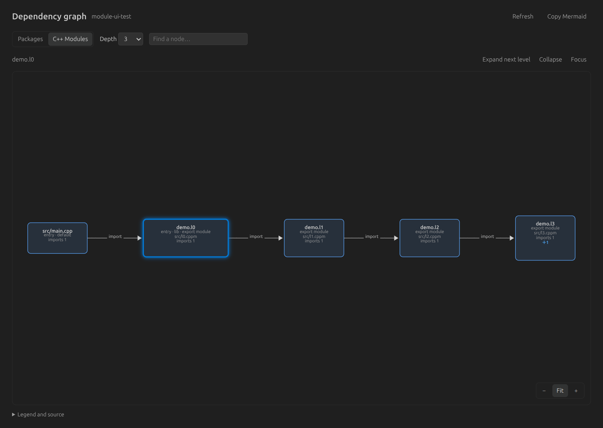
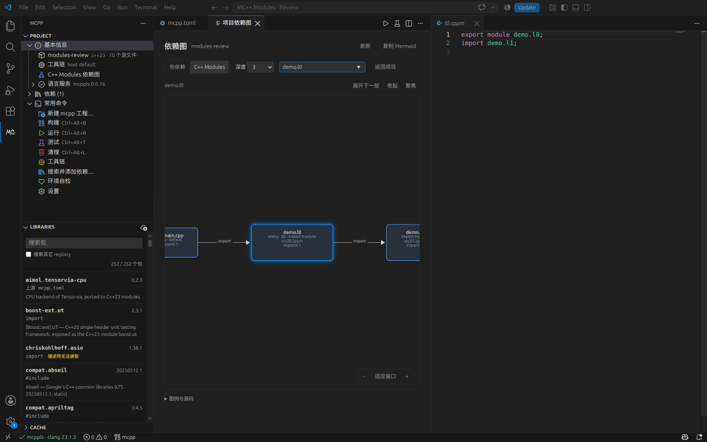
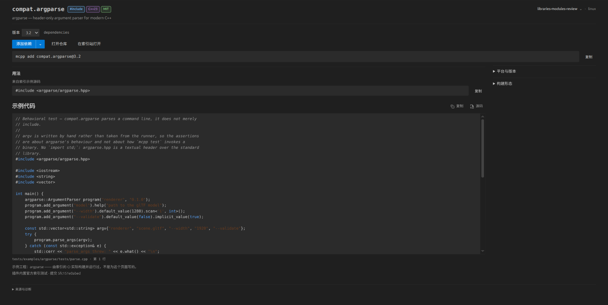

# Libraries 本地验收与 review

日期：2026-10-19（Asia/Tokyo）
分支：`feat/libraries-ux`
方案：[Libraries 与包详情页优化](2026-10-18-libraries-ux-optimisation-plan.md)

## 核心变化

1. 默认浏览官方 mcpp-index。新版路径为 `$MCPP_HOME/indices/mcpplibs`，旧版仅兼容 `registry/data/mcpplibs`；不再扫描所有 registry 并混入 xim。本机官方 252 包、xim 337 包是本次环境的观察值，不作为固定产品数量。
2. 详情顶部去掉空白占位；包名后紧跟引入方式、C++ 标准和许可证小标签。右上角切换项目并显示环境；版本选择与添加操作集中在首屏。
3. 用添加按钮旁的二级菜单选择项目、开发、构建依赖，去掉 dev checkbox。选择结果同步按钮、命令预览及声明位置；菜单支持键盘操作。
4. manifest 声明与 lock 解析版本分别展示。项目切换、磁盘修改、添加结果和异步请求都绑定对应项目与包，避免旧结果污染当前页面。
5. 详情保留单页阅读。宽屏双栏、窄屏单栏；平台矩阵、构建信息和来源诊断默认收起。无真实示例时不猜造可复制的 include/import。

真实本地 review 窗口（中文界面）：


## 本地体验

运行：

```bash
node tools/review-libraries.mjs
# 已经打包时：
node tools/review-libraries.mjs --no-package
```

脚本将 VSIX 安装到隔离扩展目录，用隔离 VS Code 用户配置打开 `.dev-profile/library-review`。使用真实 `mcpp` 与官方本地索引，保留后续手动编辑；可通过 `MCPP_DEV_CODE` 指定 VS Code 命令。进入 MC++ → Libraries，打开 `compat.argparse` 或 `compat.zlib`。

建议 review：

- 看包名标签、右上角项目选择和首屏密度；拖窄详情检查换行。
- 展开添加按钮旁的箭头，比较三种依赖类型及命令/清单预览。
- 选择 secondary 子项目，添加依赖后核对写入对应 `mcpp.toml`。
- 切换普通与开发分组，检查已有声明提示；手动修改 manifest/lock 后观察状态更新。
- 搜索并用方向键、Enter 打开详情；切换包后返回，检查查询、选项及滚动状态。

## 测试与证据

环境：Linux，VS Code 1.132.0，真实 mcpp 2026.10.16.3。

| 验证 | 结果 |
| --- | --- |
| `npm test`，包含配置、翻译、图标、生成文件一致性检查 | 709 通过，0 失败 |
| `npm run test:e2e`，真实 VS Code，语言服务五种能力变体 | 每种 8 项，共 40 通过 |
| `node tools/test-libraries-ui.mjs`，真实 VS Code Webview | 20 项通过 |
| `npm run package` | VSIX 158 文件，约 1.38 MB（含 Mermaid 与官方测试快照） |

Webview 验证覆盖：官方源及已有声明；lock 新建与删除；索引更新失败保留数据；键盘搜索及文档稳定；真实 `add --dev` 与磁盘核对；添加过程中切包；慢查询过期丢弃及跨源有限预览；项目切换后的写入位置；标签和依赖二级菜单；搜索/解析失败重试；真实 20 秒解析超时恢复；添加失败重试；侧栏宽度及过滤延迟；三种主题下的响应式布局。

侧栏按 180/280/420px 验证；详情按 480/800/1200px，在深色、浅色、高对比主题下均无横向溢出。过滤计时与布局测量、完整结果 JSON 由脚本写入 `.dev-profile/libraries-ui-artifacts/`。可选 Playwright 驱动装在仓库外，复现命令见脚本头注释。

新增行为测试覆盖新版/旧版/显式路径、默认排除 xim、项目状态覆盖与索引缓存、同名来源与依赖分组、异步操作关联、文件变化及 watcher 释放。测试夹具使用临时目录，不依赖本机包数量。

`data/buildscript-api.json` 和 `data/toml-schema.json` 另有独立 checkpoint 更新：对齐本机相邻 mcpp 仓库已跟踪 HEAD `684a306b`，使正常生成文件一致性检查通过；不是为了绕过检查而使用旧快照。

## 已知交互边界

- 当前真实 `mcpp add --help` 只有 `--dev`，没有构建依赖或分组迁移参数。构建依赖、已有声明换分组及有歧义的来源会显示准确 TOML 片段，并用“打开 mcpp.toml”完成显式编辑；不会伪造 CLI 参数或自动迁移声明。
- 跨 registry 的搜索结果缺少完整官方描述符，提供有限预览，不提供一键添加。
- “重新读取本地”和“更新 mcpp 索引”是不同操作。后者调用真实 CLI，失败时保留可用本地列表。
- 本机原生 watcher 配额接近上限，因此选中项目同时检查两个文件的内容，确保外部修改仍能更新。详情实际读到的内容也纳入比较基线，避免轮询间隔中短暂出现的 lock 状态残留。不会轮询整个包索引。

## 第二轮 review 验证

- 真实详情中能看到 `argparse::ArgumentParser` 测试正文，打开完整只读 `.cpp` 源码；本机 252 包中有 179 个匹配官方测试快照。快照来源为官方 mcpp-index 提交 `5fc151e0abed68788d9fa7b47e6e3ccb50607706`。
- 聚焦搜索输入只有一个清除按钮，清空后按钮隐藏。
- 实际 Mermaid 图验证三层本地路径依赖、索引 `compat.libpng → compat.zlib`、条件关系和第四层截断，以及复制和缩放。
- 新增纯逻辑测试覆盖共享节点、循环、开发/构建关系、路径清单、未知来源、规模上限与 Mermaid 标签转义。
- `data/library-examples.json` 由 `npm run gen:examples` 生成；可通过 `MCPP_INDEX_REPO` 指定 checkout、`MCPP_INDEX_REF` 固定提交，仅提取 Git 已跟踪的测试源文件和清单，不读取构建产物。
- 离线 Mermaid 和测试快照使 VSIX 从约 414 KB 增至约 1.37 MB，因此 CI 的体积预算从 1 MiB 调整为 2 MiB；仍限制 200 文件并禁止源码、本地 profile、文档目录泄漏，另检查 Mermaid、许可证和示例快照均已打包。


## 第三轮 review 验证

- 代码块不再继承默认内联 code 背景；复制/源码按钮与示例标题在同一行，复制反馈保持图标。
- 源码统一使用只读虚拟文档，按内容生成不可变身份；真实编辑器输入测试确认不能写入。该机制同时用于本地 checkout 与官方内置示例。
- 图首屏移除绝对路径、数量段落与长说明，改用颜色区分项目/path/索引节点，节点保留基础标签和 deps 数，连线使用完整 `库名@版本`。
- Dependencies 只展示直接依赖，命名空间不再误解析为一个包；来源在行内标记。实际点击索引依赖和 path 依赖，均进入同一图面板并高亮对应节点；传递依赖没有混入列表。
- 核心逻辑测试覆盖 URI 编码后的只读内容恢复、本地内容快照、命名空间直接依赖和图导航身份；真实 UI 验证代码背景、标题同行、源码只读、颜色差异及两类节点定位。

- 依赖图支持以鼠标位置为中心的滚轮缩放、按住鼠标拖动画布；保留节点点击高亮，拖动不会误触节点。提供 Fit 复位和 `+` / `-` / `0` 键盘操作。真实 UI 校验缩放锚点、双轴平移及复位。


## 第四轮：共享画布、C++ Modules 与侧栏层级

- 设计以方案文档 §14 为准。Basics 内保留 C++ Modules Deps；Dependencies 是其后第 2 个顶层分组，默认折叠，Common commands 随后。默认状态尊重 VS Code 保存的用户偏好；无直接依赖时省略空分组。
- 真实依赖扩展 0.0.16 的 mcppls CLI 验证 `query module --graph --root … --format json`。实际 fixture 有 `src/main.cpp → demo.l0 → … → demo.l6 → external.api → external.hidden`，以及 `[lib].path="src/l0.cppm"`。
- 图展示 main 默认入口和 lib 显式入口；3 层显示折叠控件，单支展开下一层，5 层及全部均实际验证。全部内部深度能够看到 demo.l6 和 external.api；external.hidden 始终被外部一层边界过滤，尽管这个 path 包在原始 JSON 中 external=false。
- 搜索隐藏节点进入聚焦视图，保留直接导入者并可返回项目。点击 demo.l0 在旁边打开只读虚拟源码，真实键盘写入被阻止且原始文件字节未改变；画布保持打开。切换 Packages / C++ Modules 后，选中节点与缩放平移恢复。
- Mermaid 使用全局 `htmlLabels:false`，模块卡片上的 `＋N` 是可鼠标/键盘操作的 SVG 控件。展开只重新投影已有数据，不重复运行 CLI；图布局串行执行，过期请求不覆盖当前项目或视图。
- 原有 18 项 UI 回归全部通过，新增上述 2 项，共 20 项；扩展宿主五种语言服务变体仍共 40 项通过；完整逻辑/契约测试 709 项通过。VSIX 158 文件、1,450,834 字节，包含共享画布脚本和离线 Mermaid，没有本地 profile/源码/设计文档泄漏。

### 性能探测

入口 `tools/benchmark-dependency-graphs.mjs`，使用仓库外 Playwright 和离线 Mermaid，在独立 Chromium 中测试 1,000 节点深链、1,000 节点宽扇出、45 节点/450 边共享依赖；分别投影 3 层和全部。

| 数据 | 实际渲染上限 | 子图计算 | Mermaid 布局 |
| --- | --- | --- | --- |
| 深链 | 150 节点 / 149 边 | 约 0.43–0.59 ms | 约 52–463 ms |
| 宽扇出 | 150 节点 / 149 边 | 约 0.51–0.70 ms | 约 436–529 ms |
| 共享依赖 | 45 节点 / 300 边 | 约 0.23–0.28 ms | 约 436–488 ms |

这是本机单次探测结果，不作为跨平台耗时保证。所有可见图都满足 150 节点/300 边预算；原始结果在 gitignored 的 `.dev-profile/libraries-ui-artifacts/graph-performance.json`。

### 数据边界

- mcppls 此版本全图接口最多输出 500 个模块记录；上游 truncated 或索引尚未完成会显示简短的不完整提示，不声称已展示全部项目数据。截断后缺失的模块名不会被伪造成源码文件。
- 当前接口不含声明精确行号或逐边的重导出属性，因此跳到准确文件，不自行重解析 C++、猜行号或伪造 export-import 边。
- 归属按源码最近的项目 manifest 判断；项目边界外的生成源码保守视为外部。更新源码后使用刷新重新查询。





## 第五轮：全屏与宽屏详情

- 根因：详情 body 被 `max-width:1120px; margin:0 auto` 限制，且双栏固定 2:1，导致全屏时外侧空白大、辅助栏分配过宽。
- 修正为随编辑器宽度铺开，实际内容边距 16–40px；双栏辅助信息固定在 240–320px，剩余宽度归示例代码。小于 900px 仍为单栏。
- 本轮仅调整 CSS，运行 `npm run check`、打包以及真实 VS Code 的针对性布局回归。480/800/1200/1600/2560px × 深色/浅色/高对比，共 15 个组合通过；新增断言检查实际边距、代码区占比和辅助栏宽度，同时保留无横向溢出检查。
- 测量右边距时扣除原生垂直滚动条宽度。UI 驱动的启动检查兼容 VS Code 临时空编辑器，避免误判编辑器数量。
- 可用 `MCPP_UI_ONLY_LAYOUT=1` 运行针对性布局场景；矩阵记录于 `.dev-profile/libraries-ui-artifacts/layouts.json`。全量功能测试结果见上轮，本次未重复执行不受 CSS 影响的逻辑与语言服务测试。


